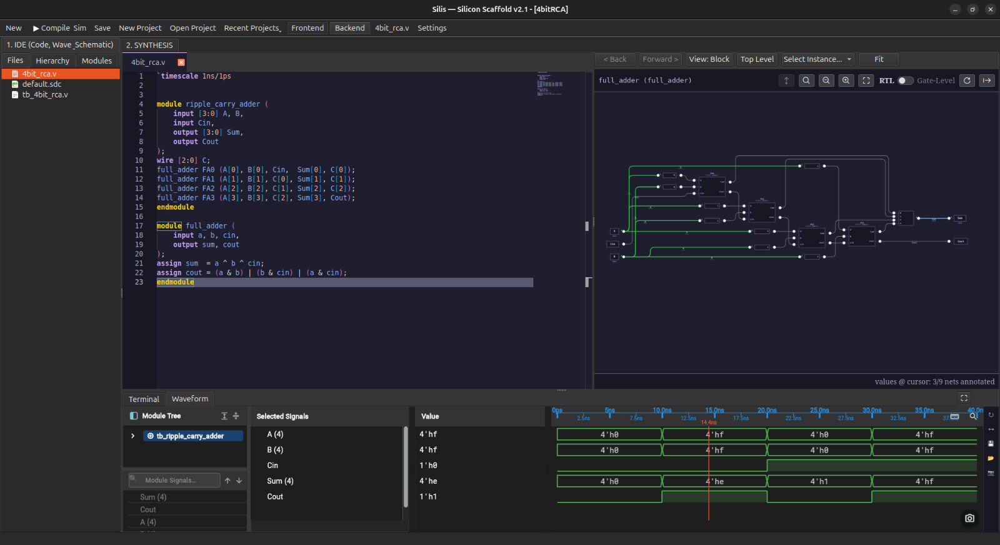

<div align="center">

<pre>
███████╗ ██╗ ██╗      ██╗ ███████╗
██╔════╝ ██║ ██║      ██║ ██╔════╝
███████╗ ██║ ██║      ██║ ███████╗
╚════██║ ██║ ██║      ██║ ╚════██║
███████║ ██║ ███████╗ ██║ ███████║
╚══════╝ ╚═╝ ╚══════╝ ╚═╝ ╚══════╝
</pre>

# SILIS — Silicon Scaffold
### Complete End-to-End RTL-to-GDSII Digital ASIC EDA Studio: GUI, CLI & Python SDK

<h4>
  <a href="#overview">Overview</a>
  ·
  <a href="#end-to-end-rtl-to-gdsii-pipeline">RTL-to-GDSII Pipeline</a>
  ·
  <a href="#core-architectural-pillars">Architecture</a>
  ·
  <a href="#key-capabilities">Capabilities</a>
  ·
  <a href="#quick-start-python-sdk">Quick Start</a>
  ·
  <a href="#pre-release-packages">Downloads</a>
  ·
  <a href="#documentation-manual">Documentation</a>
  ·
  <a href="#build-and-installation-guide">Build Guide</a>
</h4>

<p>
  
  
  
  
</p>

<br>



</div>

---

## Overview

**Silis (Silicon Scaffold)** is a complete, end-to-end digital ASIC design studio that takes digital hardware designs all the way from high-level hardware description language (RTL) sources to tapeout-ready physical GDSII mask layouts and signoff verification.

Rather than fragmenting chip development across disconnected command-line tools and point-solution visual viewers, Silis unifies the entire silicon synthesis, physical design, and verification lifecycle under a single cohesive framework:

- **Frontend RTL Elaboration & Polyglot Lowering**: Ingestion and synthesis of SystemVerilog, Verilog-2005, VHDL-2008 (via GHDL), and C/C++ High-Level Synthesis (via Bambu HLS).
- **Automated Formal Verification & Simulation**: Integrated formal equivalence and property verification wrapping SymbiYosys, accompanied by high-speed Icarus/Verilator compilation and native waveform viewing.
- **Logic Synthesis & Technology Mapping**: Constraint-driven logical optimization and standard cell mapping via Yosys.
- **Physical Design & Multi-Domain Power Architecture**: Interactive and declarative floorplanning (FPS), IEEE 1801 UPF 3.0 multi-voltage power domains, automated macro placement, power distribution mesh (PDN) synthesis, global/detailed placement, clock tree synthesis (CTS), and antenna-free detailed routing.
- **Physical Signoff & Mask Generation**: Signoff timing analysis (OpenSTA), DRC verification (Magic / KLayout), Layout Versus Schematic (Netgen LVS), and final GDSII stream-out.

Silis delivers this full RTL-to-GDSII flow across three synchronized modalities:
1. **Interactive Visual CAD (SilisIDE)**: A pure native Qt6 desktop studio with embedded Monaco HDL editors, gate-level schematic drawers, C++ accelerated layout viewers (`SiliconPeeker`), OpenROAD visual parity (`LayerViewerPanel`), and interactive congestion analytics.
2. **The Silis Python SDK (`silis.*`)**: A strongly typed, object-oriented API enabling complete headless RTL-to-GDSII automation pipelines, parametric design sweeps, and continuous integration.
3. **Automated CLI Tooling (`silis-flow`, `silis-project`)**: High-throughput terminal runners for server clusters and automated nightly builds.

---

## End-to-End RTL-to-GDSII Pipeline

Silis orchestrates proven open-source silicon engines into a seamless, deterministic flow:

```
+-----------------------------------------------------------------------------------+
|                            FRONTEND: RTL & CONSTRAINTS                            |
|  SystemVerilog / Verilog / VHDL / C++ HLS  +  IEEE 1801 UPF  +  IEEE 1497 SDC     |
+-----------------------------------------+-----------------------------------------+
                                          |
                                          v
+-----------------------------------------------------------------------------------+
|                        SYNTHESIS & FORMAL VERIFICATION                            |
|       Yosys Logic Synthesis  |  SymbiYosys Formal Check  |  Gate-Level Verilog    |
+-----------------------------------------+-----------------------------------------+
                                          |
                                          v
+-----------------------------------------------------------------------------------+
|                         FLOORPLAN & MULTI-VOLTAGE INTENT                          |
|  Core/Die Sizing  |  Macro Placement (RTL-MP / Peripheral)  |  UPF Level Shifters |
+-----------------------------------------+-----------------------------------------+
                                          |
                                          v
+-----------------------------------------------------------------------------------+
|                        POWER DISTRIBUTION NETWORK (PDN)                           |
|       Dual-Layer Orthogonal Grid  |  Power Switches  |  Static IR Drop Check      |
+-----------------------------------------+-----------------------------------------+
                                          |
                                          v
+-----------------------------------------------------------------------------------+
|                           PHYSICAL IMPLEMENTATION                                 |
|     Global Placement (RePlAce)  |  CTS (TritonCTS)  |  Detailed Routing (Triton)  |
+-----------------------------------------+-----------------------------------------+
                                          |
                                          v
+-----------------------------------------------------------------------------------+
|                              SIGNOFF & MASK STREAM                                |
|   OpenSTA Timing  |  Magic / KLayout DRC  |  Netgen LVS  |  Final GDSII Emission  |
+-----------------------------------------------------------------------------------+
```

---

## Core Architectural Pillars

### The Parity Law: Zero GUI-SDK Deviance
Silis enforces strict architectural parity: the Graphical User Interface is a presentation shell over the Python SDK. Every interactive gesture on the canvas—such as modifying RTL source files, synthesising gates, translating macros, adjusting voltage islands, or running detailed routing—invokes the identical SDK class methods used by batch scripts. This ensures that any design implemented interactively in the IDE can be reproduced verbatim in headless scripts for tapeout signoff.

### Downstream Data Integrity & Tapeout Discipline
Downstream physical design engines execute Silis instructions without manual intervention. To ensure zero fabrication defects and mask integrity:
- **Manufacturing Grid Invariance**: All coordinates and dimensions are quantized to the process manufacturing grid ($g = 0.005\ \mu\text{m}$ for SkyWater 130nm).
- **Site Row Snapping**: Standard cell and macro origins snap to standard cell row site heights ($y = k \times 2.72\ \mu\text{m}$ for `sky130_fd_sc_hd`).
- **Atomic Script Emission**: All generated OpenROAD TCL scripts, UPF intent definitions, and DEF layouts are committed to disk transactionally to eliminate truncated or corrupted files.

---

## Key Capabilities

- **Polyglot RTL Frontend**: Native ingestion and translation for Verilog, SystemVerilog, VHDL-2008, and C/C++ HLS algorithmic blocks.
- **Automated Logic Synthesis**: Full Yosys integration with automated technology mapping, gate-level schematic generation, and area/timing optimization.
- **Formal Verification & Functional Simulation**: Built-in testbench execution, VCD waveform drawer, and SymbiYosys formal property assertions.
- **Declarative Floorplan Synthesis (FPS)**: Define complex hierarchical floorplans, macro halo keepouts, and voltage islands declaratively using clean geometric constraints.
- **Automated Macro Placement**: Boundary-aware peripheral placers, OpenROAD RTL-MP sequence pairs, and electrostatic force-field analytical placement modes.
- **Multi-Voltage Power Intent (IEEE 1801 UPF 3.0)**: Native extraction of explicit domain voltages, automatic level-shifter insertion for cross-domain nets with potential gradients exceeding $0.05\text{V}$, and isolation clamp rules for gated domains.
- **Power Distribution Network (PDN) Synthesis**: Dual-layer orthogonal power mesh generation with static IR drop pre-flight checks ($\le 5\%\ V_{\text{nominal}}$) and daisy-chained power switch insertion.
- **In-Memory Timing Constraints (IEEE 1497 SDC)**: Fluent Python API for specifying clocks, input/output delays, multicycle paths, and clock uncertainty without external constraint files.
- **Complete Physical Signoff**: Automated verification wrapping OpenSTA static timing, Magic/KLayout DRC, Netgen LVS, and GDSII generation.
- **Dual Visual Engines**: Fast OpenGL DEF inspection (`SiliconPeeker`) for fluid navigation across multi-million-instance designs, alongside compiled C++ layer viewers offering visual parity with OpenROAD.

---

## Pre-Release Packages

Standalone release deliverables are published on [GitHub Releases](https://github.com/The-Silis-Foundation/silis/releases/tag/v0.1.0-pre):

- **Standalone Linux Package**: [`Silis-x86_64.AppImage`](https://github.com/The-Silis-Foundation/silis/releases/download/v0.1.0-pre/Silis-x86_64.AppImage) (Self-contained Linux executable bundling Python 3.12, Qt6 runtime, and SkyWater 130nm technology resources).
- **Differential Update Manifest**: [`Silis-x86_64.AppImage.zsync`](https://github.com/The-Silis-Foundation/silis/releases/download/v0.1.0-pre/Silis-x86_64.AppImage.zsync) (Bandwidth-efficient incremental updates via Zsync).

```bash
# Make executable and launch immediately on Linux:
chmod +x Silis-x86_64.AppImage
./Silis-x86_64.AppImage
```

---

## Quick Start (Python SDK)

Execute a complete end-to-end RTL-to-GDSII pipeline from Python:

```python
import silis

# 1. Initialize Pipeline with RTL source and target PDK
pipe = silis.Pipeline("sram_soc_system", pdk="sky130")
pipe.add_source("rtl/sram_soc_top.v")
pipe.add_source("rtl/alu.v")

# 2. Logic Synthesis & Technology Mapping
pipe.synth(top="sram_soc_top")

# 3. In-Memory Timing Constraints (IEEE 1497 SDC)
pipe.sdc.clock("clk", period=10.0, uncertainty=0.2) \
        .inputs(delay=2.0, port="rst_n") \
        .outputs(delay=1.5, port="data*")

# 4. Floorplan with Auto Macro Placer & Voltage Fences
pipe.floorplan(
    die_area=[0, 0, 1400, 1400],
    core_margin=20.0,
    auto_macro_placer="peripheral",
    regions=[
        pipe.add_fence("u_alu", origin=(300, 700), density=0.50)
    ]
)

# 5. Standard Cell Placement, CTS & Routing
pipe.place()
pipe.cts()
pipe.route()

# 6. Physical Verification & Signoff
report = pipe.signoff()
report.print_summary()

# 7. Final GDSII Stream-out & Inspection
pipe.gds()
silis.view_layout("results/temp.def", title="SRAM SoC Signoff Layout")
```

---

## Documentation Manual

The indexed engineering manual is located in [`silis/docs/`](docs/INDEX.md):

| Document | Topic | Description |
| :--- | :--- | :--- |
| **GUI User Manual** | [GUI_USER_MANUAL.md](docs/GUI_USER_MANUAL.md) | Comprehensive interactive IDE walkthrough with annotated dark mode screenshots |
| **Architecture Decision Records** | [ADR_0001](docs/architecture/ADR_0001_ZERO_GUI_SDK_DEVIANCE.md) | ADR-0001: Zero GUI-SDK Deviance and Strict Downstream Integrity |
| **Python SDK Reference** | [SILIS_PYTHON_SDK_MANUAL.md](docs/SILIS_PYTHON_SDK_MANUAL.md) | Complete SDK method reference, classes, and exceptions |
| **OpenROAD Flow Reference** | [OPENROAD_FLOW_REFERENCE.md](docs/OPENROAD_FLOW_REFERENCE.md) | Downstream OpenROAD command mapping and execution rules |
| **Floorplanning Master** | [05_advanced_floorplanning.md](docs/book/05_advanced_floorplanning.md) | Advanced slicing trees, halos, and channel corridors |

---

## Build and Installation Guide

### Prerequisites
- Linux (x86_64, Ubuntu 22.04+ or Debian 12 recommended)
- `python3` (>= 3.10), `python3-pip`, `cmake` (>= 3.16), `ninja` or `make`
- Qt6 Development Packages (`qt6-base-dev`, `qt6-webengine-dev`)
- EDA Toolchains in `$PATH`: `openroad`, `yosys`, `magic`, `netgen`

### Building Native Acceleration Modules
```bash
# Build native acceleration engines
cd silis/schematicviewer && mkdir -p build && cd build && cmake .. && make -j$(nproc) && cd ../../..
cd silis/clocktreeviewer && mkdir -p build && cd build && cmake .. && make -j$(nproc) && cd ../../..
cd silis/terminal        && mkdir -p build && cd build && cmake .. && make -j$(nproc) && cd ../../..
cd silis/editor          && mkdir -p build && cd build && cmake .. && make -j$(nproc) && cd ../../..
```

### Running the Environments
```bash
# Launch Graphical Desktop IDE
python3 silis/silis.py

# Launch Headless CLI Flow
python3 silis/cli_flow.py --project silis/projects/sram_soc_system --step all

# Run Headless UI State & Physical Verification Suite
QT_QPA_PLATFORM=offscreen SILIS_HEADLESS_TEST=1 python3 silis/tests/test_ui_state_verifier.py
```

---

## License & Attribution

Developed by **The Silis Foundation**. Licensed under the **GNU Affero General Public License v3.0 (AGPLv3)**. See [LICENSE](LICENSE) for details.
