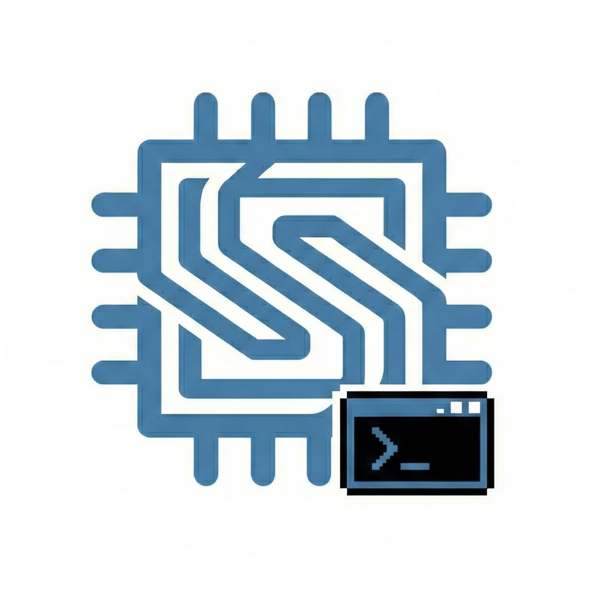

# Silis v0.1.2-pre (Pre-Release)

<p align="center">
  
</p>

<h3 align="center">Silis ASIC Design Studio</h3>

<p align="center">
  <a href="https://github.com/The-Silis-Foundation/silis/releases/tag/v0.1.2-pre"></a>
  <a href="https://github.com/The-Silis-Foundation/silis/blob/main/LICENSE"></a>
  <a href="https://codespaces.new/The-Silis-Foundation/silis-cs-edition" target="_blank" rel="noopener noreferrer"></a>
</p>

---

## Downloads

<table>
<thead>
<tr>
<th>Platform / Architecture</th>
<th>Standalone Deliverable</th>
<th>Delta Updater</th>
<th>Web / Cloud Edition</th>
<th>Source Code</th>
</tr>
</thead>
<tbody>
<tr>
<td><strong>Linux x86-64 (64-bit)</strong></td>
<td><a href="https://github.com/The-Silis-Foundation/silis/releases/download/v0.1.2-pre/Silis-x86_64.AppImage">Download AppImage (1.4 GB)</a></td>
<td><a href="https://github.com/The-Silis-Foundation/silis/releases/download/v0.1.2-pre/Silis-x86_64.AppImage.zsync">Zsync Manifest</a></td>
<td><a href="https://codespaces.new/The-Silis-Foundation/silis-cs-edition" target="_blank" rel="noopener noreferrer">Launch in Codespaces</a></td>
<td><a href="https://github.com/The-Silis-Foundation/silis/archive/refs/tags/v0.1.2-pre.tar.gz">tar.gz</a> &nbsp;|&nbsp; <a href="https://github.com/The-Silis-Foundation/silis/archive/refs/tags/v0.1.2-pre.zip">zip</a></td>
</tr>
</tbody>
</table>

---

## Quickstart

```bash
# 1. Make executable
chmod +x Silis-x86_64.AppImage

# 2. Launch Silis Studio (GUI mode)
./Silis-x86_64.AppImage

# Alternatively, invoke headless CLI flow directly
./Silis-x86_64.AppImage --projects
```

---

## System Requirements & FUSE Prerequisite Notice

Silis AppImage runs on Linux distributions with kernel >= 4.18 and GLIBC >= 2.38 (Ubuntu 24.04+, Fedora 39+, Arch, Debian 13+).

> [!NOTE]
> **Ubuntu 24.04 and RHEL 9 Users**: On desktop Ubuntu 24.04 with `fuse3`, `./Silis-x86_64.AppImage` executes directly. In minimal containers or cloud images lacking FUSE helpers, run with `--appimage-extract-and-run` or unpack via `--appimage-extract`.

---

## Verification & Checksums

| File | Size | MD5 Hash | SHA-256 Checksum |
| :--- | :--- | :--- | :--- |
| `Silis-x86_64.AppImage` | 1.4 GB | `15a157058104490be3062bd5286a0d78` | `2bae74d3f6bf37b083834d466ac6bbf558c97e64fc5eadeba8b5ce1b6bf1751f` |
| `Silis-x86_64.AppImage.zsync` | 2.7 MB | `c7bb0a15a8cb4d923f4ce6f17e3451db` | `9bd76391ff61dd5a700f8c0ec4dd8034901517c0f33997beb2ab0a0bd4a5771c` |

Verification command:
```bash
sha256sum -c <<< "2bae74d3f6bf37b083834d466ac6bbf558c97e64fc5eadeba8b5ce1b6bf1751f  Silis-x86_64.AppImage"
```

---

## Changelog

### Added
- **Editable FPS Live TCL Tab**: Unlocked `live_tcl_edit` inside `InteractiveFloorplannerWidget`'s `Execution & Live TCL` tab with dirty-edit tracking, source mode indicator, a **Regenerate TCL** control, and preservation of custom edits on Commit & Execute Flow (`run_floorplan.tcl` atomic emit).
- **SSAForge Complete Path Resolution**: Extended `SSAForge.get_pdk_paths()` and `SSAForge.resolve_tool_bin()` in `core/pdkmanagers/pdk/manager.py` alongside `assets/ssa/{sky130a,gf180mcu}/config.json` to deterministically resolve `tech_lef`, `std_cell_lef`, `extra_lefs`, `magic_tech`, `netgen_setup`, `gds_files`, `verilog_models`, and PVT `corners` without host-path leaks.
- **Zero-PyQt6 Headless Python SDK Bridge**: Guarded eager Qt widget imports across `__init__.py`, `core/pdkmanagers/pdk/manager.py`, `core/cli/flow.py`, `core/sdk/pipeline.py`, `core/sdk/viewers.py`, and `core/synthesisscripts/synthesisthread.py` so `/usr/bin/python3 -c "import silis; ..."` succeeds on minimal Linux servers without `PyQt6`.
- **Full Clean-Room KVM QEMU Unpack Suite**: Verified FUSE-less `--appimage-extract`, `--first-boot`, `--install-sdk`, `~/.silis/pdks/{sky130A,sky130B,gf180mcu}` & `~/.silis/ssa/*` hydration, host Python bridge, `yosys`/`openroad`/`sta`/`verilator`/`magic` binary execution, `SSAForge` resolution, live `sky130A.tech` Magic load, RTL synthesis, and SDK invariants on an empty Ubuntu 24.04 minimal guest VM.
- **Tier-1 DFT, Multi-Domain Power Switch Stitching & Full DEF 5.8 Export**: Added `DFTBuilder`/BSDL export, `POWER_SWITCH.VDDG` `met4` feeder trunks + stacked vias, IO power-pad trunk targeting, hierarchical stdcell discovery, and precompiled `FastLayoutViewer` / `silis_layer_viewer` C++ viewer bindings.

### Changes
- **Portable Magic Toolchain Bundling**: Rebuilt Magic `8.3.707` under `third-party/lib/magic/` and updated `third-party/bin/{magic,ext2spice,ext2sim}` to resolve `TCL_MAG_DIR` dynamically relative to `BASH_SOURCE[0]` (`CAD_ROOT` + `MAGIC_EXEC` exported cleanly by `AppRun`).
- **AppImage Shared-Library & Perl/Tcl Isolation**: Updated `packaging/bundle_shared_libs.py` and `packaging/build_appimage.sh` to purge leaked host `libQt6*.so.6` from `usr/lib/x86_64-linux-gnu` so PyQt6 uses its bundled `Qt 6.12.1` cleanly, scan `third-party/{lib,plugins,OpenSTA/build,OpenROAD/build/src}`, bundle `usr/share/tcltk/tcl8.6`, prefer `repo/assets/ssa` and hydrated `~/.silis/pdks` over stale `.silis_backup_audit`, and strip `CMakeFiles`/`__pycache__` with `--delete-excluded`.
- **Minimal `perl-base` Verilator Wrapper**: Updated `third-party/bin/verilator` with `File::Basename` + `Cwd::realpath` fallbacks when `FindBin` or `Pod::Usage` (`Encode.pm`) are absent on minimal Linux images.

### Fixes
- **First-Boot Auto-Hydration & External `PDK_ROOT`**: Updated `core/setup_wizard.py` and `core/config.py` with completeness scoring so `~/.silis/pdks` and `~/.silis/ssa` auto-hydrate cleanly without overwriting user/external `PDK_ROOT` overrides.
- **CTS, GDS, LVS & GLS Signoff Pipelines**: Resolved CTS prompt-race conditions, Magic abstract `LEFview` clearing during GDS streamout (`backendflow.py`, `signoff_flow.py`), topological LVS comparison against post-P&R netlists (`lvs_engine.py`), Verilator `5.053` GLS fallback (`gls_engine.py`), and single-macro floorplan session synchronization.
