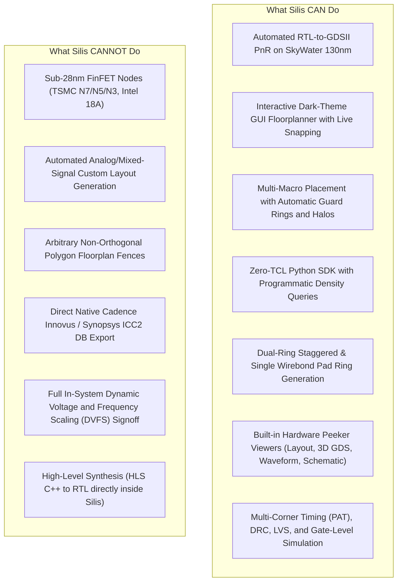

# ⚡ Silis Capabilities, Features & Interface Parity Guide (`Capability.md`)

*A complete, transparent matrix of what Silis can and cannot do, its core features, and the exact physical design flags and capabilities that are accessible vs. left out across the GUI, Python SDK, and CLI.*

---

## 📑 Table of Contents
1. [Executive Summary: What Silis Can and Cannot Do](#1-executive-summary-what-silis-can-and-cannot-do)
2. [Supported Technologies & Tool Integrations](#2-supported-technologies--tool-integrations)
3. [Interface Parity Matrix (GUI vs. SDK vs. CLI)](#3-interface-parity-matrix-gui-vs-sdk-vs-cli)
4. [Flag-by-Flag Deep Dive: Exposed, Hidden & Inaccessible Knobs](#4-flag-by-flag-deep-dive-exposed-hidden--inaccessible-knobs)
   - 4.1 [Synthesis (`yosys`)](#41-synthesis-yosys)
   - 4.2 [Floorplanning & Core Initialization](#42-floorplanning--core-initialization)
   - 4.3 [I/O Pin Placement & Pad Ring Engineering](#43-io-pin-placement--pad-ring-engineering)
   - 4.4 [Tapcells & Power Distribution (PDN)](#44-tapcells--power-distribution-pdn)
   - 4.5 [Standard Cell Placement (`gpl` / `dpl`)](#45-standard-cell-placement-gpl--dpl)
   - 4.6 [Clock Tree Synthesis (`cts`)](#46-clock-tree-synthesis-cts)
   - 4.7 [Routing (`grt` / `drt`)](#47-routing-grt--drt)
   - 4.8 [Fill, Antenna Diodes & Metal Density](#48-fill-antenna-diodes--metal-density)
   - 4.9 [Physical Verification (DRC, LVS, Signoff)](#49-physical-verification-drc-lvs-signoff)
5. [UX Strengths & Known Operational Boundaries](#5-ux-strengths--known-operational-boundaries)
6. [Summary Recommendation](#6-summary-recommendation)

---

## 1. Executive Summary: What Silis Can and Cannot Do

### What Silis CAN Do:
- **Zero-TCL Digital ASIC Physical Design**: Run full RTL-to-GDSII digital flow using Python scripts, CLI commands, or a unified Qt6 GUI.
- **Hierarchical Floorplanning**: Compute module gate counts and dynamic silicon utilization, define hierarchical fences, place hard macros (`.lef` / `.lib`), assign orientations (`R0`, `R90`, `R180`, `R270`, `MX`, `MY`), and generate keep-out halos.
- **Full-Chip I/O Pad Ring Synthesis**: Automatically configure single-row peripheral wirebond pad rings or dense dual-row staggered pad frames with corner cell cutouts, matching ESD pad drivers (`sky130_ef_io__*`).
- **Interactive Multi-Viewer Ecosystem**: Inspect DEF layouts in 2D (`SiliconPeeker`), view extruded 3D layers (`GDS3D`), view simulation waveforms (`SignalPeeker`), and debug logic gate netlists (`DigitalJS`).
- **Automated Replay & Patching**: Non-destructively preserve user manual TCL customizations in `run_floorplan.tcl` while regenerating dependent flow scripts.

### What Silis CANNOT Do:
- **Advanced FinFET Nodes**: Silis is optimized for open-source planar PDKs (specifically SkyWater 130nm `sky130A` / `sky130B`). It does not support multi-patterning, EUV coloring, or FinFET design rule decks (e.g. 7nm / 5nm / 3nm).
- **Non-Manhattan Polygon Fences**: Floorplan regions and macro bounds must be rectilinear (bounding boxes aligned to the X/Y manufacturing grid). Non-orthogonal (diagonal/circular) fences are not supported.
- **Native Proprietary Database Export**: Silis operates strictly on standard open formats (`LEF`, `DEF`, `GDSII`, `ODB`, `Liberty .lib`, `SDC`). It does not write proprietary Cadence OA (OpenAccess) or Synopsys Milkyway/NDM databases.
- **Analog Circuit Synthesis**: Silis is a digital cell-based PnR platform; it does not synthesize custom analog schematics into transistors.

---

## 2. Supported Technologies & Tool Integrations

| Subsystem | Underlying Engine | Silis Role |
| :--- | :--- | :--- |
| **Logic Synthesis** | Yosys | Netlist elaboration, technology mapping to standard cell library, ABC optimization |
| **Floorplanning** | Silis Engine + OpenROAD | Interactive QGraphicsScene canvas, density solver, `initialize_floorplan`, macro placement |
| **I/O Placement** | Silis IOPlacer + OpenROAD | Peripheral pin spacing, edge grouping, pad ring site array synthesis |
| **Tapcells & PDN** | OpenROAD (`tapcell`, `pdngen`) | Latchup prevention tap insertion, metal power grid straps (met4/met5 rings and meshes) |
| **Global/Detail Placement**| OpenROAD RePlAce + OpenDP | Electrostatic global placement, macro halo avoidance, legal cell snapping |
| **Clock Tree Synthesis** | OpenROAD TritonCTS | H-tree buffer synthesis, skew minimization, clock sink clustering |
| **Global/Detail Route** | FastRoute + TritonRoute | 3D maze routing, grid-based pin access, DRC-clean detailed wire routing |
| **DRC / Fill / GDS** | Magic VLSI + KLayout | Metal fill insertion, antenna check, GDS streaming, physical DRC verification |
| **Static Timing (PAT)** | OpenSTA | Multi-corner setup/hold analysis, WNS/TNS calculation, power dissipation |
| **Waveforms / Simulation** | Icarus Verilog + GTKWave | RTL and gate-level testbench simulation with VCD waveform tracing |

---

## 3. Interface Parity Matrix (GUI vs. SDK vs. CLI)

The table below contrasts feature availability across the three interfaces:

| Feature / Capability | GUI | Python SDK | CLI (`silis.cli`) |
| :--- | :---: | :---: | :---: |
| **Interactive Drag & Drop Floorplan** | Yes | No (Scripted only) | No |
| **Live WYSIWYG Pin Positioning** | Yes | No (Box constraints) | No |
| **Real-time Utilization & Density Queries** | Yes (Visual overlay) | Yes (`get_utilization`) | Limited (Summary only) |
| **Programmatic Design Optimization Loops**| No | Yes (Native Python) | No (External shell) |
| **Single-Ring Wirebond Pad Allocation** | Yes (Dialog / Toolbar) | Yes (`pad_strategy="single"`) | Yes (`--pad single`) |
| **Dual-Ring Staggered Pad Allocation** | Yes (Dialog / Toolbar) | Yes (`pad_strategy="staggered"`) | Yes (`--pad staggered`) |
| **Custom Macro Halo Margins** | Yes (Properties panel) | Yes (`macro_halos={...}`) | Limited (Uniform halo) |
| **Interactive 3D GDS Viewer** | Yes (Toolbar button) | Yes (`view_gds3d()`) | No |
| **Interactive Digital Logic Inspector** | Yes (Schematic view) | Yes (`view_schematic()`) | No |
| **Batch Headless CI/CD Execution** | No | Yes (`headless=True`) | Yes (`silis run --all`) |
| **Step-by-Step Interactive Stepping** | Yes (Pipeline bar) | Yes (`pipe.step()`) | Yes (`silis step <name>`) |
| **Detailed DRC Violation Marker Overlay** | Yes (Canvas crosshair)| Yes (`DRCReport.markers`) | No (Text log only) |
| **Hard Macro Packaging & Export** | Yes (IOPlacer Export button)| Yes (`pipe.export_macro()`) | Limited (via SDK script) |

---

## 4. Flag-by-Flag Deep Dive: Exposed, Hidden & Inaccessible Knobs

### 4.1 Synthesis (`yosys`)
- **Exposed in GUI/SDK**: Top module name, source file lists, PDK target (`sky130`), clock period constraint.
- **Hidden / Defaults Applied by Silis**:
  - `flatten` vs. hierarchical preservation: Defaulted to structural flatten for optimal cross-boundary logic optimization.
  - ABC script selection: Defaulted to standard area/delay balance (`abc -liberty ...`).
- **Inaccessible in GUI/CLI**: Direct manual modification of internal ABC LUT mapping rules without editing `silis/synthengine/synth.py` directly.

### 4.2 Floorplanning & Core Initialization
- **Exposed**:
  - `die_area`: `[x0 y0 x1 y1]` in microns.
  - `core_area`: Core boundary coordinates or uniform margins (`core_margin`).
  - `site`: Manufacturing site (`unithd`).
- **Hidden / Silis Defaults**:
  - Manufacturing track pitch (`make_tracks`): Automatically extracted from `techlef` for all routing layers (`li1` through `met5`).
- **Inaccessible via GUI**: Non-rectangular dies (L-shaped, T-shaped). GUI strictly forces rectangular bounding boxes.

### 4.3 I/O Pin Placement & Pad Ring Engineering
- **Exposed in GUI**: Edge selector (Top, Bottom, Left, Right), pin ordering, pitch adjustment, single vs. dual staggered strategy.
- **Exposed in SDK**: `pipe.iopins(hor_layers, ver_layers, corner_avoidance, min_distance, pin_constraints=[...])`.
- **Hidden / Automated by Silis**:
  - Inner pad row offset: Hardcoded to $210\,\mu\text{m}$ (single/outer tier) and $420\,\mu\text{m}$ (inner tier) based on Sky130 pad geometry.
  - Corner cell generation: Automatically instantiates `sky130_ef_io__corner_pad` at four corners during pad ring expansion.
- **Inaccessible in CLI**: Arbitrary manual coordinate offsets per pad without writing custom TCL.

### 4.4 Tapcells & Power Distribution (PDN)
- **Exposed in GUI/SDK**: Tapcell pitch/distance (`-distance 14`), tapcell master cell name (`sky130_fd_sc_hd__tapvpwrvgnd_1`).
- **Hidden / Automated by Silis**:
  - PDN strap pitch and width: Automatically calculated based on core width/height to avoid routing starvation.
  - Power nets: Always hardcoded to `VDD` and `VSS` (1.8V nominal core supply).
- **Inaccessible in GUI**: Custom multi-rail power domains (e.g. separate `VDDIO` 3.3V rails vs. `VDDCORE` 1.8V rails require manual edits in `run_pdn.tcl`).

### 4.5 Standard Cell Placement (`gpl` / `dpl`)
- **Exposed in SDK**: `density` (target placement density, e.g. `0.45` to `0.70`), `pad_left`, `pad_right` (cell site padding to prevent DRC violations).
- **Hidden / Handled Automatically**:
  - Uniform density vs. wirelength optimization balance (`overflow` threshold).
  - Cell padding removal before detailed placement (`detailed_placement`).
- **Inaccessible in GUI**: Direct tuning of RePlAce electrostatic wirelength weight $\lambda$ without opening TCL.

### 4.6 Clock Tree Synthesis (`cts`)
- **Exposed in SDK**: `sink_clustering` (boolean), root clock buffer master, CTS buffer list.
- **Hidden / Silis Defaults**:
  - Max slew (`0.75 ns`), max capacitance (`0.2 pF`).
  - Standard clock buffer selection: Automatically selects `sky130_fd_sc_hd__clkbuf_1`, `sky130_fd_sc_hd__clkbuf_2`, `sky130_fd_sc_hd__clkbuf_4`, and `sky130_fd_sc_hd__clkbuf_8`.
- **Inaccessible in GUI**: Multi-source tree mesh configuration (Silis uses standard CTS tree synthesis).

### 4.7 Routing (`grt` / `drt`)
- **Exposed in SDK**: `congestion_iterations`, `bottom_layer`, `top_layer`, `layer_adjustments`.
- **Hidden / Auto-Tuned**:
  - `-allow_congestion`: Now enabled by default in Silis routing to ensure global routes hand off successfully to detailed routing.
  - Fix for rogue signal nets marked as POWER/GROUND: Silis runs a pre-route check to sanitize signal nets and prevent TritonRoute crashes (`DRT-0305`).
- **Inaccessible in GUI**: Detailed router thread count, stubborn tile iteration maximums, and rip-up penalties (defaults set to 8 threads, 50 iterations).

### 4.8 Fill, Antenna Diodes & Metal Density
- **Exposed**: Decap cell insertion, fill cell insertion (`sky130_fd_sc_hd__fill_*`), antenna diode cell (`sky130_fd_sc_hd__diode_2`).
- **Hidden**: Minimum area threshold for antenna insertion.
- **Inaccessible in GUI/CLI**: Manual metal density dummy fill tiling patterns (relies on Magic/KLayout fill engines).

### 4.9 Physical Verification (DRC, LVS, Signoff)
- **Exposed in SDK**:
  - `pipe.signoff("pat")` -> Multi-corner timing and power summary.
  - `pipe.signoff("drc")` -> Exact count of physical DRC errors and layer locations.
  - `pipe.signoff("lvs")` -> Device and net match summary.
- **Hidden**: Extraction parasitics tolerance (`spef` generation corners).
- **Inaccessible in CLI**: Visual interactive cross-probing between schematic net and layout net.

### 4.10 Hard Macro Packaging & Export (`macro_exporter`)
- **Exposed in GUI**: "Export Hard Macro" action in IOPlacer / Floorplanner.
- **Exposed in SDK**: `pipe.export_macro(macro_name, pdk_name, corners, def_path, gds_path, verilog_path, sdc_path)`.
- **Delivered Package**: Deposited into `~/.silis/macrocache/<pdk>/<macro_name>/`:
  - Physical abstract LEF with internal routing blockage.
  - Full merged GDSII via Magic.
  - Verilog blackbox stub (`.v`) and functional simulation model (`.sim.v`).
  - LVS CDL / SPICE netlist (`.spice`) and SDC constraints.
  - Multi-corner Liberty models (`lib/`) across 5 PVT corners (`ss_100C_1v60`, `tt_025C_1v80`, `ff_n40C_1v95`, `ss_n40C_1v40`, `ff_100C_1v95`).
  - Multi-corner parasitic SPEF files (`spef/`) and machine-readable `manifest.json`.
- **Hidden / Defaults Applied by Silis**:
  - Characterization slew/load grid automatically sized for SkyWater 130nm standard cells.
  - Pin pitch guard: Silis enforces $\ge 1.0\,\mu\text{m}$ pitch on exported macro pins to prevent downstream router DRC shorts.
- **Inaccessible in CLI**: No dedicated single CLI flag like `silis export-macro` exists yet (must run via Python SDK or GUI).

---

## 5. UX Strengths & Known Operational Boundaries

### Strengths:
1. **Interactive WYSIWYG Feedback**: Macro moves, rotations, halo edits, and pad rings update in the canvas in real-time.
2. **Crash-Resistant Script Preservation**: Unlike classic EDA tools that overwrite hand-edited scripts, Silis parses existing TCL blocks and non-destructively preserves custom constraints.
3. **Programmatic Reflection**: Python SDK allows querying `get_utilization()` and `get_required_area()` directly to write closed-loop automated floorplan optimization scripts.

### Operational Boundaries:
1. **Pad Placement Sequence**: Top-level I/O ports MUST be placed before standard cell placement (`run_place.tcl`). The Silis flow automates this, but manual TCL modifications must maintain this order.
2. **Signal Types on Regular Nets**: Any regular nets accidentally defined with `POWER` or `GROUND` signal types in the netlist will cause TritonRoute to terminate. Silis includes an automated sanitization pass in `route.tcl`.
3. **Macro Pitch**: All custom hard macros in Sky130 must have pin pitches $\ge 1.0\,\mu\text{m}$ to prevent pin short violations during detailed routing.

---

## 6. Summary Recommendation

- **Use the GUI** when:
  - Exploring floorplan architectures, sizing the die visually, placing macros, or inspecting layers with SiliconPeeker.
- **Use the Python SDK** when:
  - Building parameterized multi-macro chips, running algorithmic area sweeps, automating multi-corner frequency characterization, or integrating into automated regression pipelines.
- **Use the CLI** when:
  - Running automated batch compilation on remote headless build servers or CI/CD runners.
