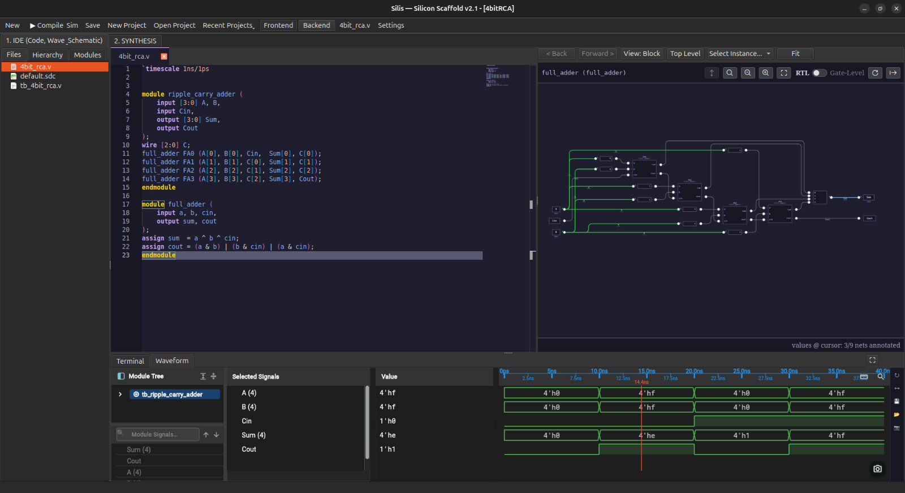
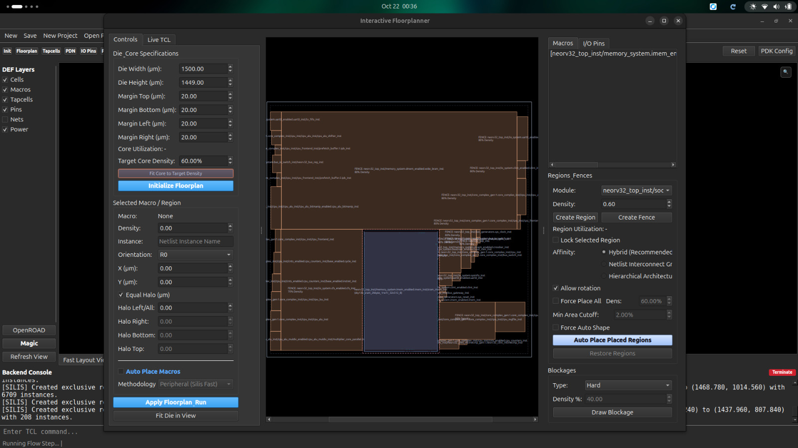
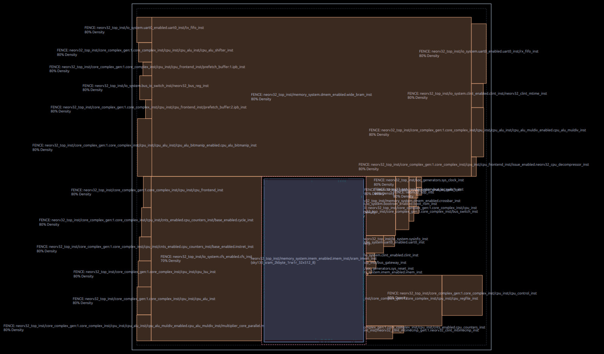
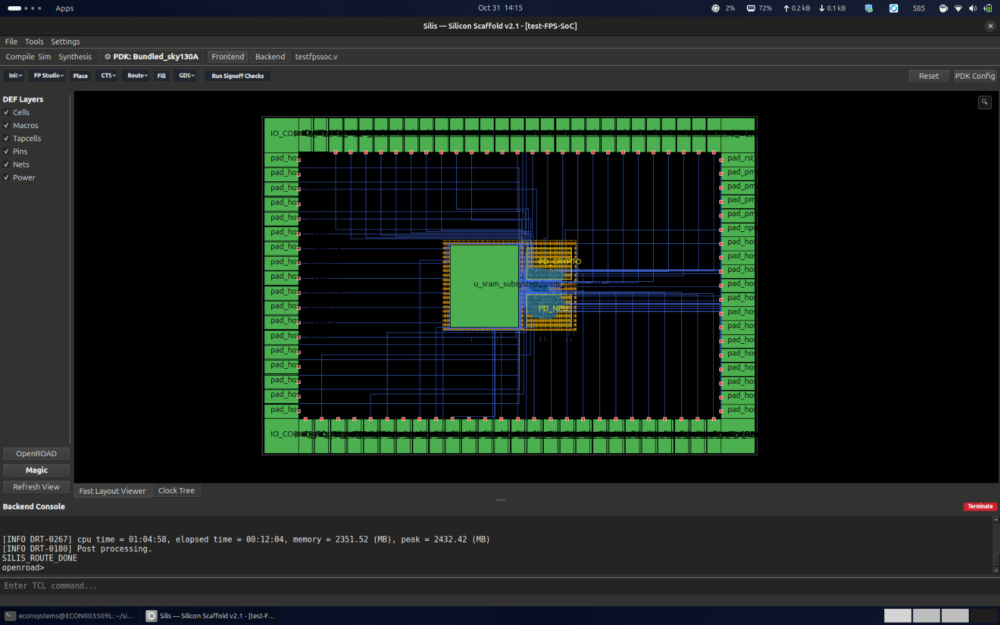
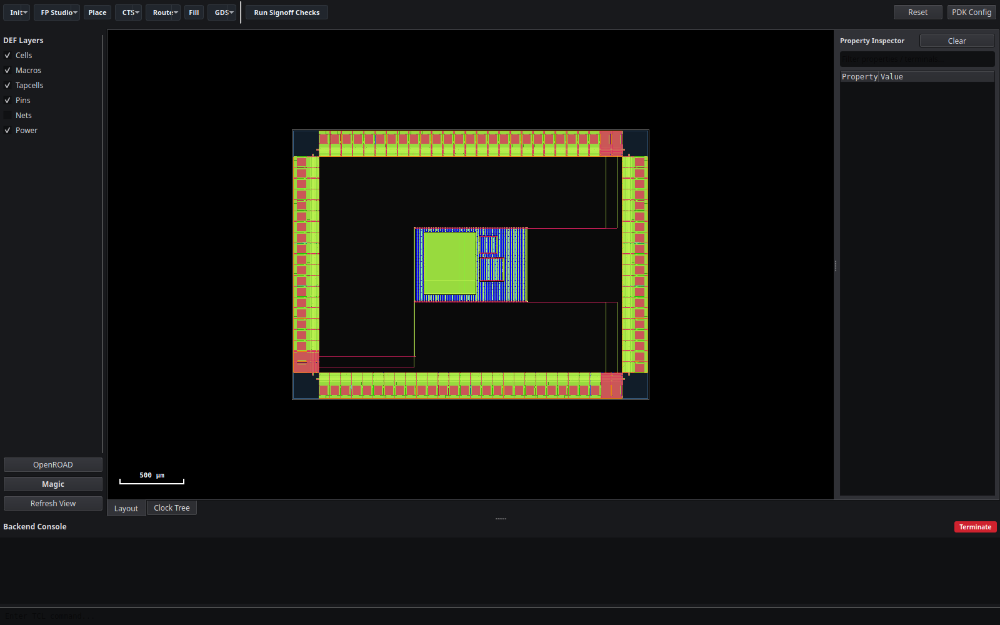
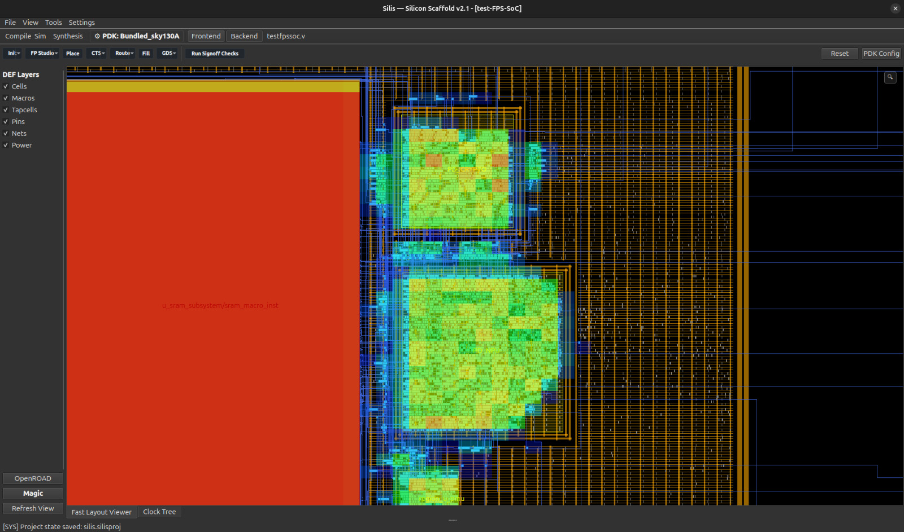
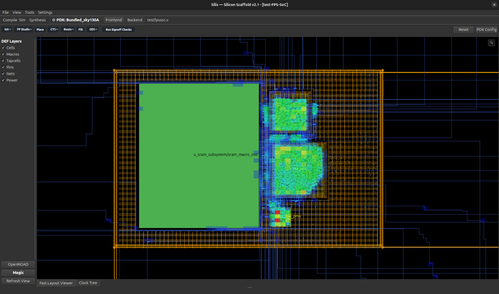
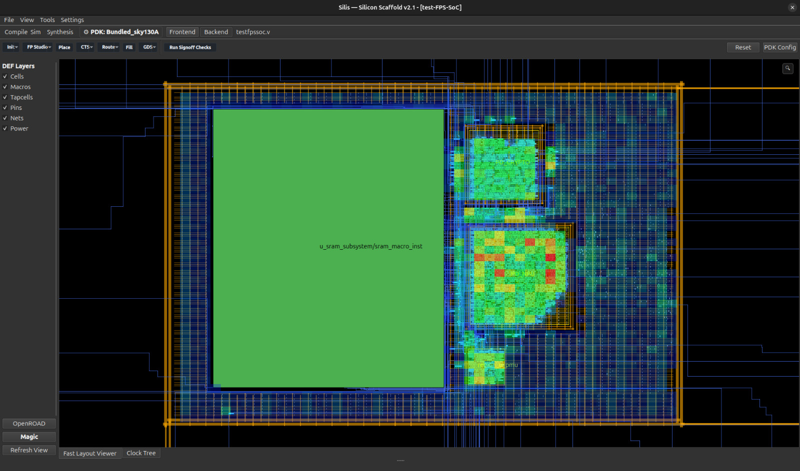

# Silis GUI User Manual & Interactive Physical Design Guide

## 1. Introduction & Architecture Overview

**Silis** is a mission-critical ASIC physical design EDA platform and multi-domain power studio. The Silis Graphical User Interface (SilisIDE) provides a pure native Qt6 presentation shell built strictly on top of the underlying Python SDK (`silis.core.sdk`).

### 1.1 The Parity Law
Silis enforces the **Zero GUI-SDK Deviance Law**:
- Every button click, interactive macro drag, halo clearance calculation, and power mesh synthesis executes the exact same underlying SDK class method that headless batch scripts invoke.
- Calculations are never performed exclusively in the presentation layer; state mutations flow deterministically through the core geometric and electrical models.

$$\text{User Interaction / Qt Event} \longrightarrow \text{Silis SDK Object Method} \longrightarrow \text{Physical State Mutation} \longrightarrow \text{Canvas View Update}$$

---

## 2. Main Workspace Layout & Flow Modalities

The Silis physical design studio organizes ASIC implementation into three primary coordinated panes:



1. **Left Navigation & Flow Control Dock**:
   - Project tree hierarchy, RTL elaboration sources, and design flow stages (Synthesis, Floorplan, Placement, CTS, Routing, Signoff).
2. **Central Physical Viewport (Dual Inspection Canvas)**:
   - Real-time OpenGL-accelerated physical layout inspection (`FastSiliconPeeker`) and OpenROAD visual parity rendering (`LayerViewerPanel`).
3. **Right Hierarchy & Terminal Dock**:
   - Instance hierarchy inspector, cell type breakdown, and live process execution terminal.

---

## 3. Floorplanning & Declarative Floorplan Synthesis (FPS)

Floorplanning establishes physical silicon boundaries, core area, standard cell row sites, keepouts, and peripheral pads.



### 3.1 Die and Core Sizing
- **Die Area**: Defines the outer perimeter of the semiconductor silicon substrate $(x_1, y_1, x_2, y_2)$ in microns ($\mu\text{m}$).
- **Core Area**: Defines the routable standard-cell cavity enclosed within the die boundaries:
  $$\text{core.left} \ge \text{die.left} + \text{margin}_{\text{left}}$$
  $$\text{core.bottom} \ge \text{die.bottom} + \text{margin}_{\text{bottom}}$$
  $$\text{core.right} \le \text{die.right} - \text{margin}_{\text{right}}$$
  $$\text{core.top} \le \text{die.top} - \text{margin}_{\text{top}}$$

### 3.2 Manufacturing Grid Legalization
Every coordinate adjusted in the GUI is automatically quantized to the manufacturing grid of the target technology:
- For SkyWater 130nm (`sky130_fd_sc_hd`):
  $$g = 0.005\ \mu\text{m} \quad (5\ \text{DBU})$$
  $$(x \pmod{g}) = 0, \quad (y \pmod{g}) = 0$$
- Macro $y$-origins automatically snap to unit site row heights ($y = k \times 2.72\ \mu\text{m}$).

### 3.3 Automated Macro & Regional Placement
Silis incorporates boundary-aware peripheral auto-placement algorithms to align macros and memory blocks with legal halo clearances:



---

## 4. Interactive Physical Inspection (SiliconPeeker)

`FastSiliconPeeker` provides hardware-accelerated, real-time DEF layout visualization with high frame rates, responsive panning, and sub-pixel culling.



### 4.1 Mouse & Keyboard Navigation
| Input Action | Operation | Physical Function |
| :--- | :--- | :--- |
| **Left Click + Drag** | Pan Viewport | Smooth translation across large die cavities |
| **Scroll Wheel** | Cursor-Centered Zoom | Smooth focal magnification without drift |
| **Right Click + Drag** | Marquee Zoom | Instant framing of selected die coordinate bounding box |
| **Middle Click** | Measure Distance / Ruler | Interactive Euclidean distance calculation ($\mu\text{m}$) |
| **Ctrl + F** | Search Instance | Jump to and highlight component or macro terminal |
| **R** | Reset Zoom | Re-center viewport to extents of die boundary |

### 4.2 Cell Classification & Color Architecture
Silis maintains semantic color distinctions to prevent visual confusion between structural cells:
- **Standard Cells**: Grouped and colored according to functional logic partitions.
- **Physical Tapcells**: Filtered by cell master patterns (`tap*`, `sky130_fd_sc_hd__tapvpwrvgnd_1`) to prevent filler and decap pollution.
- **Macros / Blocks**: Prominently framed with keepout halos and pin connection flylines.
- **Power Rails**: Rendered with distinct metal layer coloring (e.g., `met4` trunks, `met5` straps).

---

## 5. Native OpenROAD Visual Parity & Layer Viewer

For signoff validation matching OpenROAD's native graphics engine, Silis embeds the `LayerViewerPanel` backed by compiled C++ rendering bindings.



### 5.1 Layer Visibility & Color Palette
- **Layer Stacks**: Independent toggles for individual routing layers (`met1` through `met5`), vias (`via1` through `via4`), and blockage layers.
- **Pin & Terminal Visibility**: Inspect macro terminal pins, power distribution trunks, and boundary I/O connections with full C++ hardware acceleration.

---

## 6. Physical Heatmap Analytics & Congestion

Silis features multi-spectral analytics engines to evaluate physical design viability before downstream routing and signoff:

### 6.1 Placement Cell Density Heatmap
Visualizes cell utilization distribution across the core cavity to prevent localized routing congestion hotspots:



### 6.2 Routing Track Congestion Analysis
Evaluates horizontal and vertical routing track demand against channel capacity:



### 6.3 Multi-Domain Power Density Distribution
Displays power consumption gradients and highlights regions requiring reinforced PDN trunks:



---

## 7. Multi-Voltage Power Intent (IEEE 1801 UPF 3.0)

Silis provides dedicated controls for multi-domain power management:

1. **Power Domain Definition**:
   - Declare voltage islands (`PD_TOP`, `PD_CORE`, `PD_LOWPWR`) with explicit supply net potentials (e.g., $1.800\text{V}$, $0.950\text{V}$). Monolithic uniform defaults are strictly prohibited.
2. **Isolation Policies**:
   - Configure clamp cells and isolation nets for signals crossing from gated domains to active domains:
     ```tcl
     set_isolation iso_core -domain PD_CORE -clamp_value 0 -applies_to outputs
     ```
3. **Power Distribution Network (PDN)**:
   - Configure orthogonal dual-layer meshes (horizontal straps on $M_i$, vertical trunks on $M_{i-1}$) with automatic static IR drop verification ($\le 5\%\ V_{\text{nominal}}$).
   - Generate daisy-chained power switches with controlled inrush current sequencing.

---

## 8. Exporting Downstream Signoff Artifacts

Silis exports clean, deterministic scripts ready for downstream execution:

1. **Floorplan DEF**: Emits quantized, DRC-legalized macro positions and core boundaries.
2. **OpenROAD TCL Scripts**: Defensive TCL commands (`floorplan.tcl`, `pdn.tcl`, `route.tcl`) written atomically with zero coordinate truncation.
3. **UPF 3.0 Specification**: IEEE 1801 multi-voltage power intent contracts.
4. **SDC Constraints**: IEEE 1497 clock, delay, and timing margin definitions.
