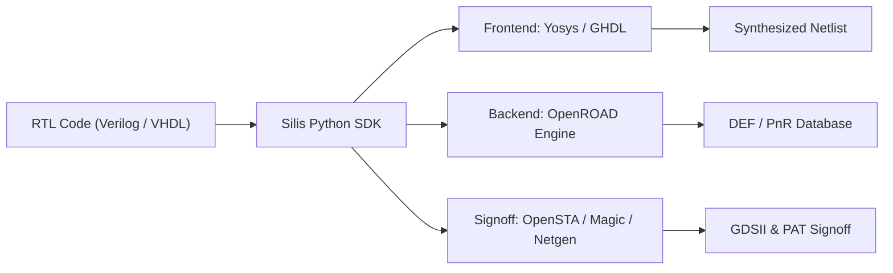
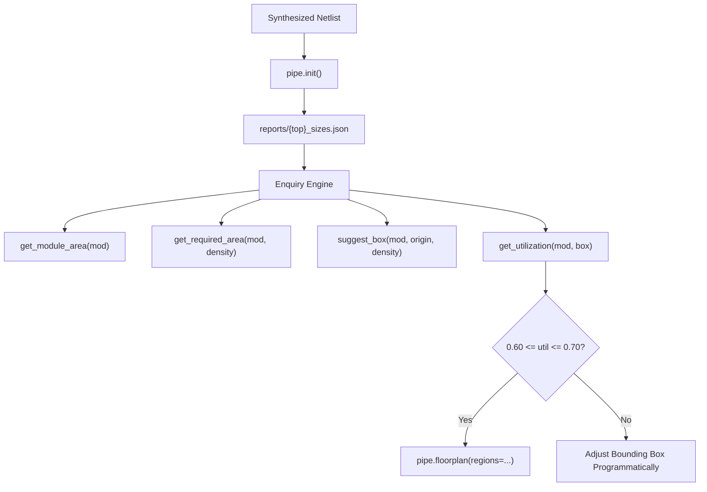

# 📘 Silis Python SDK: The Complete Architectural Guide & Reference Manual

*An exhaustive, fully-indexed programmer's manual for programmatic ASIC design, physical floorplanning, RTL-to-GDSII pipeline execution, and post-layout verification using the Silis Python SDK.*

---

## 📑 Table of Contents

1. [Chapter 1: Architecture & Foundation](#chapter-1-architecture--foundation)
   - 1.1 Philosophy & The Zero-TCL Promise
   - 1.2 System Architecture & Qt Event Loop Integration
   - 1.3 Installation, Dependencies & Environment Initialization
2. [Chapter 2: Project Management (`silis.Project`)](#chapter-2-project-management-silisproject)
   - 2.1 Project Discovery & Configuration (`.silisproj`)
   - 2.2 Physical Asset Resolution (LEF, LIB, Verilog, DEF, GDS, SDC)
   - 2.3 Macro Memory Discovery & Periphery Auto-Placement
   - 2.4 Mutation, Serialization & State Persistence
3. [Chapter 3: Physical Floorplanning & Enquiry Engine](#chapter-3-physical-floorplanning--enquiry-engine)
   - 3.1 Overview of Programmatic Silicon Density & Utilization
   - 3.2 `get_utilization()` & Polymorphic Region Queries
   - 3.3 `get_required_area()` & Dynamic Block Dimensioning
   - 3.4 `suggest_box()` & Manufacturing Grid Snapping
   - 3.5 Module Introspection & Hierarchical Inspection
   - 3.6 Automated Programmatic Tuning Loops
4. [Chapter 4: Programmatic ASIC Pipeline (`silis.Pipeline`)](#chapter-4-programmatic-asic-pipeline-silispipeline)
   - 4.1 Context Management (`with silis.Pipeline(...) as pipe:`)
   - 4.2 Lifecycle Sequencing & Qt Event Pumping
   - 4.3 Native Step Execution Methods:
     - `pipe.synthesis()`
     - `pipe.init()`
     - `pipe.floorplan()`
     - `pipe.tapcells()`
     - `pipe.pdn()`
     - `pipe.iopins()`
     - `pipe.place()`
     - `pipe.cts()`
     - `pipe.route()`
     - `pipe.fill()`
     - `pipe.gds()`
     - `pipe.signoff()`
     - `pipe.dft()`
     - `pipe.lvs()`
     - `pipe.gls()`
     - `pipe.tapeout()`
     - `pipe.export_macro()`
5. [Chapter 5: Signoff Analytics & Report Objects](#chapter-5-signoff-analytics--report-objects)
   - 5.1 `SynthesisReport` (RTL gate metrics, WNS, power)
   - 5.2 `SignoffReport` (Multi-corner PAT slacks & power)
   - 5.3 `DRCReport` (Physical geometric rule violations)
   - 5.4 `DFTSignoffReport` (Scan chains & ATPG fault coverage)
   - 5.5 `LVSSignoffReport` (Layout vs. schematic equivalence)
   - 5.6 `GLSSignoffReport` (Gate-level back-annotated simulation)
   - 5.7 `TapeoutManifestReport` (Packaging checklist & checksums)
6. [Chapter 6: Interactive & Headless Visual Peeker Engines](#chapter-6-interactive--headless-visual-peeker-engines)
   - 6.1 `view_layout()` (FastSiliconPeeker DEF Layout Viewer)
   - 6.2 `view_gds3d()` (OpenGL 3D Silicon Peeker)
   - 6.3 `view_waveforms()` (SignalPeeker & GTKWave Viewer)
   - 6.4 `view_schematic()` (DigitalJS Interactive Logic Inspector)
   - 6.5 `open_gui()` (Robotic Desktop & GUI Driver)
7. [Chapter 7: Production Flow Cookbook & Recipes](#chapter-7-production-flow-cookbook--recipes)
   - 7.1 Recipe 1: 10-Line Minimal RTL-to-GDS Flow
   - 7.2 Recipe 2: Multi-Macro SRAM SoC with Guard Rings
   - 7.3 Recipe 3: 12-Fence Intel Pentium Processor Floorplan (60%–70% Utilization)
   - 7.4 Recipe 4: Automated Multi-Corner Frequency Sweep Loop
8. [Appendix: Master Alphabetical API Index](#appendix-master-alphabetical-api-index)

---

# Chapter 1: Architecture & Foundation

### 1.1 Philosophy & The Zero-TCL Promise
Traditional digital ASIC implementation requires chip designers to author thousands of lines of brittle, vendor-specific Tool Command Language (TCL) scripts. These scripts lack type safety, proper object-oriented abstraction, robust unit testing, and dynamic data-driven reasoning.

The **Silis Python SDK** replaces manual TCL scripting with a pure, Pythonic API:
- **First-Class Citizens**: Modules, bounding boxes, macro instances, regions, and DRC reports are strongly-typed Python objects.
- **Dynamic Programmatic Feedback**: Chip dimensions, macro coordinates, and standard cell fence utilizations can be computed dynamically at runtime using `if/else` logic, optimization loops, and algorithmic solvers.
- **Zero-TCL Guarantee**: All PnR stages—from synthesis to final multi-corner signoff—can be parameterized entirely using native Python dictionaries, lists, floats, and booleans.



### 1.2 System Architecture & Qt Event Loop Integration
Silis is engineered around a hybrid architectural runtime:
1. **Application Runtime**: Built on `PyQt6`, providing an asynchronous execution bridge (`QProcess`, `QThread`) to underlying EDA tools (OpenROAD, Yosys, Magic, Netgen).
2. **Headless Execution Guard**: When running scripts from the CLI or CI/CD pipelines, the SDK automatically sets `QT_QPA_PLATFORM="offscreen"` to enable 100% headless execution without requiring an X11 server or physical monitor.
3. **Pumping Events**: Methods in [`silis.Pipeline`](file:///home/eatheswar/silisfoundation/silis/sdk/pipeline.py) explicitly pump the Qt event loop via `process_events()`, ensuring subprocess buffers, inter-process communication (IPC) queues, and timers never deadlock.

### 1.3 Installation, Dependencies & Environment Initialization
The Silis SDK requires Python $\ge 3.10$ and `PyQt6`.

```python
import os
import sys

# Ensure silis package is available on path
sys.path.insert(0, "/path/to/silisfoundation")

import silis
from silis import Project, Pipeline, SignoffReport, SynthesisReport
```

---

# Chapter 2: Project Management (`silis.Project`)

The [`silis.Project`](file:///home/eatheswar/silisfoundation/silis/sdk/project.py) class encapsulates all files, configuration, target PDKs, macros, reports, and generated physical artifacts belonging to an ASIC design.

### 2.1 Project Discovery & Configuration (`.silisproj`)
A Silis project is defined by a JSON-formatted configuration file named `<project_name>.silisproj` located inside the project directory:

```json
{
  "project_name": "gemm_rv32_pentium_soc",
  "top_module": "gemm_pentium_top",
  "pdk": "sky130",
  "macros": [
    "sky130_sram_1kbyte_1rw1r_32x256_8",
    "sky130_sram_2kbyte_1rw1r_32x512_8"
  ],
  "auto_sdc": true,
  "clock_period": 20.0
}
```

#### Instantiation Methods:
```python
# Load an existing project directory
proj = silis.Project("/home/eatheswar/silisfoundation/silis/projects/gemm_rv32_pentium_soc")

# Or use the top-level factory
proj = silis.load_project("sram_soc_system")

# Create a brand new project programmatically
new_proj = silis.create_project(
    name="my_accelerator",
    top_module="accel_top",
    pdk="sky130",
    root_dir="/workspace/projects/my_accelerator"
)
```

### 2.2 Physical Asset Resolution
`Project` exposes properties to resolve physical assets on disk:

```python
# Absolute directory paths
print(proj.root_dir)     # /.../gemm_rv32_pentium_soc
print(proj.source_dir)   # /.../gemm_rv32_pentium_soc/source
print(proj.netlist_dir)  # /.../gemm_rv32_pentium_soc/netlist
print(proj.results_dir)  # /.../gemm_rv32_pentium_soc/results
print(proj.reports_dir)  # /.../gemm_rv32_pentium_soc/reports

# Primary design artifacts
print(proj.primary_verilog)  # Path to top RTL Verilog
print(proj.primary_netlist)  # Path to synthesized gate-level netlist
print(proj.primary_def)      # Path to results/temp.def
print(proj.primary_gds)      # Path to results/design.gds
print(proj.primary_sdc)      # Path to timing constraints SDC
```

### 2.3 Macro Memory Discovery & Periphery Auto-Placement
When SRAM macros are referenced in `.silisproj`, the `Project` scans `source/` and PDK libraries for matching `.lef` and `.lib` timing files:

```python
# Returns dictionary of discovered macro files
macros_info = proj.macro_files
# Output:
# {
#   "sky130_sram_1kbyte_1rw1r_32x256_8": {
#       "lef": "/path/to/.../sky130_sram_1kbyte.lef",
#       "lib": "/path/to/.../sky130_sram_1kbyte.lib"
#   }
# }
```

### 2.4 Mutation, Serialization & State Persistence
Project properties can be updated and persisted back to disk:

```python
proj.top_module = "gemm_pentium_top_rev2"
proj.pdk = "sky130"
proj.macros.append("sky130_sram_4kbyte")
proj.save()  # Overwrites .silisproj
```

---

# Chapter 3: Physical Floorplanning & Enquiry Engine

The **Enquiry Engine** is an integrated geometry calculator that bridges logical gate-level synthesis and physical silicon floorplanning. It allows scripts to inspect module gate areas in $\mu\text{m}^2$, compute target bounding boxes, and verify standard cell density bounds programmatically.



### 3.1 Overview of Programmatic Silicon Density
Utilization is defined as:
$$\text{Utilization} = \frac{\text{Standard Cell Area } (\mu\text{m}^2)}{\text{Allocated Bounding Box Area } (\mu\text{m}^2)}$$

The Silis SDK normalizes utilization on a scale of `0.0` to `1.0` ($0\% - 100\%$).

### 3.2 `get_utilization()` & Polymorphic Region Queries
[`get_utilization()`](file:///home/eatheswar/silisfoundation/silis/sdk/project.py#L388-L442) supports two calling styles:

#### Style A: Direct Module and Box Query
```python
# Pass module name and a bounding box [x1, y1, x2, y2]
util = pipe.get_utilization("u_integer_alu", area=[100.0, 1350.0, 189.125, 1439.125])
print(f"ALU Density: {util:.2%}")  # Output: ALU Density: 68.00%

# Pass module name and a raw area float in um^2
util = pipe.get_utilization("u_muldiv_bm", area=27700.0)

# Pass module name and a width/height tuple
util = pipe.get_utilization("u_frontend", area=(43.2, 43.2))
```

#### Style B: Region Dictionary Query
```python
region = {
    "module": "u_regfile_hpm",
    "box": [950.0, 1050.0, 1216.415, 1316.415],
    "is_fence": False
}
util = pipe.get_utilization(region)
print(f"Regfile Density: {util:.2%}")  # Output: Regfile Density: 65.00%
```

### 3.3 `get_required_area()` & Dynamic Block Dimensioning
Computes the exact physical silicon area in $\mu\text{m}^2$ necessary to achieve a desired target utilization:

```python
# What area is needed to keep the coprocessor at exactly 60% utilization?
req_area = pipe.get_required_area("u_gemm_pe_array", target_density=0.60)
print(f"Required Silicon Area: {req_area:.2f} um^2")
```

### 3.4 `suggest_box()` & Manufacturing Grid Snapping
Calculates an optimal rectangular bounding box `[x1, y1, x2, y2]` from a given origin coordinate `(x, y)` to satisfy `target_density` and `aspect_ratio`. Coordinates are automatically snapped to the PDK manufacturing grid ($5\,\text{nm}$ grid on Sky130):

```python
box = pipe.suggest_box(
    module="u_cpu_control",
    origin=(650.0, 1150.0),
    target_density=0.65,
    aspect_ratio=1.0,  # 1.0 = Square box
    grid_snap=0.005    # Snap to 5nm grid
)
print(f"Suggested Bounding Box: {box}")
# Output: [650.0, 1150.0, 716.625, 1216.625]
```

### 3.5 Module Introspection & Hierarchical Inspection
Inspect hierarchical sub-modules discovered in the synthesized netlist:

```python
# List all hierarchical module instances
subsystems = pipe.get_modules()
print(f"Discovered {len(subsystems)} blocks: {subsystems}")

# Query raw cell area for any block in um^2
alu_area = pipe.get_module_area("u_integer_alu")
core_area = pipe.get_module_area("core")  # Whole design std cells
```

### 3.6 Automated Programmatic Tuning Loops
Combine the enquiry functions with programmatic logic to validate floorplan layouts before PnR:

```python
for mod_name in pipe.get_modules():
    area = pipe.get_module_area(mod_name)
    target = 0.65 if area > 2000 else 0.60
    box = pipe.suggest_box(mod_name, origin=(100.0, 100.0), target_density=target)
    util = pipe.get_utilization(mod_name, box)
    
    # Conditional assertion
    if not (0.60 <= util <= 0.70):
        raise ValueError(f"Block {mod_name} density {util:.2%} outside 60-70% window!")
```

---

# Chapter 4: Programmatic ASIC Pipeline (`silis.Pipeline`)

The [`silis.Pipeline`](file:///home/eatheswar/silisfoundation/silis/sdk/pipeline.py) class is the execution engine for the physical design flow. It provides granular Python methods for each step, context management, and automatic report extraction.

### 4.1 Context Management (`with silis.Pipeline(...) as pipe:`)
Using the `with` statement ensures all database checkpoints, worker processes, and Qt resources are cleanly initialized and finalized:

```python
proj = silis.Project("silis/projects/gemm_rv32_pentium_soc")

with silis.Pipeline(proj) as pipe:
    pipe.init()
    # Execute flow steps...
```

### 4.2 Lifecycle Sequencing & Execution Rules
- Every flow method returns a boolean (`True` on success, `False` on failure).
- Scripts should guard steps using assertions (`assert pipe.place(), "Placement failed!"`) to halt immediately on errors and prevent downstream tool crashes.
- The pipeline updates `results/temp.def` after each physical step as the checkpoint.

### 4.3 Native Step Execution Methods

#### `pipe.synthesis(corner="tt", mcmm=None, dft=False, flatten=False, tcl=None) -> SynthesisReport`
Executes Yosys logic synthesis, cell mapping, timing closure with OpenSTA, and optional scan chain insertion or hierarchy flattening.
- **`corner`**: Primary operating corner for timing & tech mapping (e.g., `"tt"`, `"ss_100C_1v60"`, `"ff_n40C_1v95"`).
- **`mcmm`**: Dictionary mapping scenario names to corner library paths for Multi-Corner Multi-Mode analysis (`{"setup": "...", "hold": "..."}`).
- **`dft`**: Boolean enabling full scan chain insertion and ATPG testability.
- **`flatten`**: Boolean (`True`/`False`) instructing Yosys to flatten the module hierarchy before tech mapping.
- **`synth`**: Alias for `pipe.synthesis()`.

```python
# Standard balanced synthesis
report = pipe.synth(corner="tt_025C_1v80", flatten=True)

# MCMM multi-scenario synthesis
report = pipe.synth(
    corner="tt_025C_1v80",
    mcmm={"setup_slow": "ss_100C_1v60", "hold_fast": "ff_n40C_1v95"},
    dft=True,
    flatten=False
)
```

#### `pipe.init(tcl=None, density=None) -> bool`
Initializes OpenROAD, links PDK LEF/LIB files, macro LEFs, and reads the synthesized gate-level netlist. Extracts `{top}_sizes.json` for the Enquiry Engine.
If `density` is supplied (e.g. `density=0.60`), automatically initializes a core area matching the requested cell utilization.
```python
pipe.init()
```

#### `pipe.floorplan(...) -> bool`
Defines die bounds, core margins, hard macro positions, orientations, halos, soft blockages, and hierarchical regions.
```python
pipe.floorplan(
    die_area=(0.0, 0.0, 2400.0, 2400.0),
    core_margin=20.0,
    macros=[
        {"inst": "u_imem_bank0", "cell": "sky130_sram_1kbyte_1rw1r_32x256_8", "pos": [100.0, 1850.0], "orient": "R0", "halo": [12.0, 12.0, 12.0, 12.0]},
        {"inst": "u_dmem_bank1", "cell": "sky130_sram_1kbyte_1rw1r_32x256_8", "pos": [1800.0, 1850.0], "orient": "MY", "halo": [12.0, 12.0, 12.0, 12.0]},
    ],
    regions=[
        {"module": "u_integer_alu", "box": [100.0, 1350.0, 189.125, 1439.125], "is_fence": False},
        {"module": "u_muldiv_bm",   "box": [100.0, 1050.0, 266.435, 1216.435], "is_fence": False},
    ],
    blockages=[
        # Soft routing highways (allowing vertical routing via access)
        {"box": [100.0, 1780.0, 2300.0, 1820.0], "soft": True},
        {"box": [100.0, 950.0, 2300.0, 990.0],   "soft": True},
    ]
)
```

#### `pipe.tapcells(...) -> bool`
Inserts well-tap and endcap boundary cells to satisfy PDK latch-up and N-well DRC spacing rules.
```python
pipe.tapcells(distance=14, endcap_cpp=1)
```

#### `pipe.pdn(tcl=None) -> bool`
Synthesizes the VDD and VSS power distribution grid straps and standard cell rails.
```python
pipe.pdn()
```

#### `pipe.iopins(...) -> bool`
Constrains and places peripheral IO pins along die edges with pitch rules, layer assignments, and corner avoidance.
```python
pipe.iopins(
    hor_layers="met3",
    ver_layers="met4",
    corner_avoidance=40.0,
    min_distance=5.0,
    pin_constraints=[
        {"pins": ["clk", "rst_n"], "region": "bottom:1000-1400"},
        {"pins": ["uart_rxd", "uart_txd"], "region": "bottom:1800-2200"},
        {"pins": ["irq", "status_done"], "region": "bottom:200-600"},
        {"pins": ["spi_sclk", "spi_mosi", "spi_miso", "spi_csn"], "region": "top:800-1600"},
        {"pins": [f"gpio_in[{i}]" for i in range(8)], "region": "left:400-2000"},
        {"pins": [f"gpio_out[{i}]" for i in range(8)], "region": "right:400-2000"},
    ]
)
```

#### `pipe.place(density=0.50, pad_left=2, pad_right=2, timing_driven=True) -> bool`
Executes routability-driven global placement (RePlAce), region clustering, cell padding removal, and detailed placement legalization.
- **`density`**: Target placement density override (e.g. `0.60` or `0.70`).
- **`pad_left` / `pad_right`**: Placement cell site padding in sites to prevent localized pin congestion.
- **`timing_driven`**: Enables wirelength and timing slack driven cell spreading.

```python
pipe.place(density=0.60, pad_left=2, pad_right=2, timing_driven=True)
```

#### `pipe.auto_shape_regions(module_names=None, target_density=0.70, min_cutoff_pct=3.0, core_margin=15.0, as_fence=False) -> dict`
High-level geometric solver that automatically calculates optimal bounding boxes, shapes modules with site snapping, and legally places 1 to N inclusive floorplanning regions.
- **`module_names`**: Optional explicit list of submodules to shape (e.g. `["u_sub0", "u_sub1", ...]`).
- **`target_density`**: Target regional standard-cell density (e.g. `0.70` for 70% regional utilization).
- **`min_cutoff_pct`**: Hierarchical module contribution cutoff (e.g. `3.0%`). Modules consuming >= 3% of the total design area are automatically shaped.
- **`core_margin`**: Clearance in µm between the die edge and region placement cavity.

```python
# Automatically discover and shape all modules contributing >= 3% of cell area to 70% density:
pipe.auto_shape_regions(target_density=0.70, min_cutoff_pct=3.0)
```

#### `pipe.db` (OpenROAD OpenDB Inspection & Query Engine)
First-class Python object exposing direct, high-speed queries to the active physical design database:
- **`pipe.db.die_area`**: Returns `(x1, y1, x2, y2)` tuple in µm.
- **`pipe.db.core_area`**: Returns `(x1, y1, x2, y2)` tuple in µm.
- **`pipe.db.utilization`**: Returns exact standard-cell core utilization ratio (`float`).
- **`pipe.db.get_instances(macro_only=False)`**: Returns list of `OpenDBInstance` objects with `.name`, `.master`, `.x`, `.y`, `.orientation`, and `.is_macro`.
- **`pipe.db.get_pins()`**: Returns list of `OpenDBPin` objects with `.name`, `.direction`, `.layer`, and coordinate `.x`, `.y`.

```python
print(f"Die Bounds: {pipe.db.die_area}")
print(f"Realized Utilization: {pipe.db.utilization * 100:.2f}%")
for m in pipe.db.get_instances(macro_only=True):
    print(f"Macro {m.name} placed at ({m.x}, {m.y})")
```

#### `pipe.cts(root_buf=None, buf_list=None, sink_clustering=True) -> bool`
Synthesizes balanced clock distribution networks using TritonCTS, inserts clock buffers, and legalizes newly inserted buffers onto discrete site rows.
```python
pipe.cts(sink_clustering=True)
```

#### `pipe.route(...) -> bool`
Runs FastRoute global routing with layer adjustments, fixes rogue power nets, and invokes TritonRoute detailed routing.

> [!NOTE]
> `pipe.route()` automatically injects `-allow_congestion` into the global router invocation, ensuring that temporary localized routing congestion is cleanly handed off to TritonRoute detailed routing rather than terminating the flow prematurely.

```python
pipe.route(
    congestion_iterations=50,
    bottom_layer="met1",
    top_layer="met5",
    layer_adjustments={"met1": 0.5, "met2": 0.3, "met3": 0.2}
)
```

#### `pipe.fill(tcl=None) -> bool`
Inserts decap and standard cell filler cells to satisfy metal density rules.
```python
pipe.fill()
```

#### `pipe.gds(tcl=None) -> bool`
Streams out the final physical design into GDSII format using Magic.
```python
pipe.gds()
```

#### `pipe.signoff(step="pat") -> Any`
Executes post-layout verification and returns structured report objects. Supported checks: `"pat"`, `"drc"`, `"antenna"`, `"dft"`, `"lvs"`, `"gls"`, `"tapeout"`.
```python
pat = pipe.signoff("pat")
print(f"Timing Status: {pat.timing_status}, WNS: {pat.wns} ns, Power: {pat.total_power_mw} mW")
```

#### `pipe.export_macro(...) -> Dict[str, str]`
Exports the routed design as a foundry-grade **Hard Macro Package** compliant with SkyWater 130nm open-source standards and deposits it into `~/.silis/macrocache/<pdk>/<macro_name>/`.

Generates:
- Abstract LEF (`<macro_name>.lef`) with internal metal obstruction blockages
- Full merged physical GDSII (`<macro_name>.gds`)
- Verilog blackbox stub (`<macro_name>.v`) and gate-level simulation model (`<macro_name>.sim.v`)
- SPICE CDL netlist (`<macro_name>.spice`) and timing constraints (`<macro_name>.sdc`)
- Multi-corner Liberty models (`lib/<macro_name>__<corner>.lib`) across 5 PVT corners (`ss_100C_1v60`, `tt_025C_1v80`, `ff_n40C_1v95`, `ss_n40C_1v40`, `ff_100C_1v95`)
- Multi-corner SPEF parasitics and machine-readable `manifest.json`

```python
pkg = pipe.export_macro(
    macro_name="my_hard_accelerator",
    pdk_name="sky130"
)

print(f"Exported to: {pkg['cache_dir']}")
print(f"LEF Path:    {pkg['lef']}")
print(f"GDS Path:    {pkg['gds']}")
print(f"Liberty TT:  {pkg['lib_tt']}")
```

---

# Chapter 5: Signoff Analytics & Report Objects

All report objects are parsed and extracted by [`silis.sdk.report`](file:///home/eatheswar/silisfoundation/silis/sdk/report.py).

### 5.1 `SynthesisReport`
Returned by `proj.get_synthesis_report()`:
```python
synth = proj.get_synthesis_report()
print(f"Cell Count : {synth.cells}")
print(f"Gate Area  : {synth.area} um^2")
print(f"WNS Slack  : {synth.wns} ns")
print(f"Timing Met : {synth.is_clean}")
print(f"Total Power: {synth.total_power}")
```

### 5.2 `SignoffReport` (PAT Signoff)
Returned by `pipe.signoff("pat")` or `proj.get_signoff_report()`:
```python
pat = proj.get_signoff_report()
print(f"Timing Status    : {pat.timing_status}")  # 'MET' or 'VIOLATED'
print(f"Worst Slack (WNS): {pat.wns} ns")
print(f"Total Die Area   : {pat.area} um^2")
print(f"Standard Cells   : {pat.cells}")
print(f"Total Chip Power : {pat.total_power_mw} mW")
print(f"Critical Trace   : {pat.critical_path_trace}")
```

### 5.3 `DRCReport`
Returned by `pipe.signoff("drc")` or `proj.get_drc_report()`:
```python
drc = proj.get_drc_report()
print(f"DRC Clean  : {drc.is_clean}")
print(f"Violations : {drc.violation_count}")
for v in drc.violations:
    print(f"  • Type: {v.type}, Box: {v.bbox}, Layers: {v.layers}")
```

### 5.4 `DFTSignoffReport`
Returned by `pipe.dft()`:
```python
dft = pipe.dft()
print(f"Fault Coverage : {dft.fault_coverage:.2%}")
print(f"Total Vectors  : {dft.vector_count}")
print(f"Scan Chains    : {dft.chain_count}")
```

### 5.5 `LVSSignoffReport`
Returned by `pipe.lvs()`:
```python
lvs = pipe.lvs()
print(f"LVS Clean : {lvs.is_clean}")
print(f"Mismatches: {lvs.mismatch_count}")
```

### 5.6 `GLSSignoffReport`
Returned by `pipe.gls()`:
```python
gls = pipe.gls()
print(f"GLS Passed: {gls.passed}")
print(f"Cycles Run: {gls.cycles_simulated}")
```

### 5.7 `TapeoutManifestReport`
Returned by `pipe.tapeout()`:
```python
manifest = pipe.tapeout()
print(f"GDS MD5 Checksum : {manifest.gds_md5}")
print(f"Foundry Package  : {manifest.package_tar}")
```

---

# Chapter 6: Interactive & Headless Visual Peeker Engines

The SDK provides standalone viewer invocation functions in [`silis.sdk.viewers`](file:///home/eatheswar/silisfoundation/silis/sdk/viewers.py) for visual inspection:

```python
# Launch fast OpenGL 2D DEF layout viewer
silis.view_layout("silis/projects/gemm_rv32_pentium_soc")

# Launch 3D Silicon Peeker
silis.view_gds3d("silis/projects/gemm_rv32_pentium_soc")

# Launch SignalPeeker interactive waveform viewer
silis.view_waveforms("results/waveform.vcd")

# Launch DigitalJS interactive logic schematic inspector
silis.view_schematic("reports/digitaljs.html")

# Launch Interactive Floorplanner Studio dialog
silis.open_floorplanner("edge_ai_crypto_soc")

# Launch Silis I/O Placer Studio dialog
silis.open_ioplacer("edge_ai_crypto_soc")
```

---

# Chapter 7: Production Flow Cookbook & Recipes

### 7.1 Recipe 1: 10-Line Minimal RTL-to-GDS Flow
```python
import silis

proj = silis.Project("projects/tiny_soc")
with silis.Pipeline(proj) as pipe:
    assert pipe.init()
    assert pipe.floorplan(die_area=(0, 0, 1000, 1000))
    assert pipe.tapcells()
    assert pipe.pdn()
    assert pipe.iopins()
    assert pipe.place()
    assert pipe.cts()
    assert pipe.route()
    assert pipe.gds()
    pat = pipe.signoff("pat")
    print(f"Done! Timing: {pat.timing_status}, WNS: {pat.wns} ns")
```

### 7.2 Recipe 2: 12-Fence Intel Pentium Processor Floorplan (60%–70% Target Utilization)
```python
import silis

proj = silis.Project("silis/projects/gemm_rv32_pentium_soc")
with silis.Pipeline(proj) as pipe:
    assert pipe.init()

    # 1. Define 12 Functional Subsystems with Target Densities
    regions_plan = [
        {"module": "u_code_cache",        "origin": (600.0, 1950.0),  "target": 0.60},
        {"module": "u_frontend",          "origin": (1050.0, 1950.0), "target": 0.65},
        {"module": "u_data_cache",        "origin": (1450.0, 1950.0), "target": 0.65},
        {"module": "u_integer_alu",       "origin": (100.0, 1350.0),  "target": 0.68},
        {"module": "u_muldiv_bm",         "origin": (100.0, 1050.0),  "target": 0.68},
        {"module": "u_cpu_control",       "origin": (650.0, 1150.0),  "target": 0.65},
        {"module": "u_regfile_hpm",       "origin": (950.0, 1050.0),  "target": 0.65},
        {"module": "u_gemm_pe_array",     "origin": (1750.0, 1350.0), "target": 0.60},
        {"module": "u_gemm_dma_agu",      "origin": (1750.0, 1050.0), "target": 0.65},
        {"module": "u_memory_crossbar",   "origin": (650.0, 650.0),   "target": 0.65},
        {"module": "u_system_dma",        "origin": (1450.0, 650.0),  "target": 0.65},
        {"module": "u_peripheral_ring",   "origin": (1000.0, 650.0),  "target": 0.60},
    ]

    # 2. Synthesize Snapped Bounding Boxes
    fences = []
    for plan in regions_plan:
        mod = plan["module"]
        box = pipe.suggest_box(mod, origin=plan["origin"], target_density=plan["target"])
        actual_util = pipe.get_utilization(mod, box)
        assert 0.599 <= actual_util <= 0.701, f"{mod} density out of bounds!"
        fences.append({"module": mod, "box": box, "density": plan["target"], "is_fence": False})

    # 3. Configure SRAM Macros & Soft Routing Corridors
    macros = [
        {"inst": "u_imem_bank0",      "cell": "sky130_sram_1kbyte_1rw1r_32x256_8", "pos": [100.0, 1850.0],  "orient": "R0", "halo": [12.0, 12.0, 12.0, 12.0]},
        {"inst": "u_dmem_bank1",      "cell": "sky130_sram_1kbyte_1rw1r_32x256_8", "pos": [1800.0, 1850.0], "orient": "MY", "halo": [12.0, 12.0, 12.0, 12.0]},
        {"inst": "u_sram_wide2k",     "cell": "sky130_sram_2kbyte_1rw1r_32x512_8", "pos": [100.0, 100.0],   "orient": "R0", "halo": [15.0, 15.0, 15.0, 15.0]},
        {"inst": "u_sram_dmem_bank2", "cell": "sky130_sram_1kbyte_1rw1r_32x256_8", "pos": [1800.0, 100.0],  "orient": "MY", "halo": [12.0, 12.0, 12.0, 12.0]},
        {"inst": "u_sram_wide_bram",  "cell": "sky130_sram_1kbyte_1rw1r_32x256_8", "pos": [950.0, 100.0],   "orient": "R0", "halo": [12.0, 12.0, 12.0, 12.0]},
    ]
    highways = [
        {"box": [100.0, 1780.0, 2300.0, 1820.0], "soft": True},
        {"box": [100.0, 950.0, 2300.0, 990.0],   "soft": True},
        {"box": [100.0, 560.0, 2300.0, 600.0],   "soft": True},
    ]

    # 4. Execute PnR Steps
    assert pipe.floorplan(die_area=(0.0, 0.0, 2400.0, 2400.0), core_margin=20.0, macros=macros, regions=fences, blockages=highways)
    assert pipe.tapcells(distance=14, endcap_cpp=1)
    assert pipe.pdn()
    assert pipe.iopins(
        hor_layers="met3", ver_layers="met4",
        pin_constraints=[
            {"pins": ["clk", "rst_n"], "region": "bottom:1000-1400"},
            {"pins": ["uart_rxd", "uart_txd"], "region": "bottom:1800-2200"},
            {"pins": ["irq", "status_done"], "region": "bottom:200-600"},
            {"pins": ["spi_sclk", "spi_mosi", "spi_miso", "spi_csn"], "region": "top:800-1600"},
            {"pins": [f"gpio_in[{i}]" for i in range(8)], "region": "left:400-2000"},
            {"pins": [f"gpio_out[{i}]" for i in range(8)], "region": "right:400-2000"},
        ]
    )
    assert pipe.place()
    assert pipe.cts()
    assert pipe.route(congestion_iterations=60, layer_adjustments={"met1": 0.5, "met2": 0.3, "met3": 0.2})
    assert pipe.gds()

    pat = pipe.signoff("pat")
    print(f"PAT Signoff: WNS={pat.wns}ns, Area={pat.area}um^2, Power={pat.total_power_mw}mW")
```

---

# Appendix: Master Alphabetical API Index

| Symbol / Endpoint | Signature / Syntax | Description |
|:---|:---|:---|
| [`create_project`](file:///home/eatheswar/silisfoundation/silis/sdk/project.py#L182) | `(name, top_module, pdk, root_dir) -> Project` | Programmatically instantiates a new project on disk. |
| [`DFTSignoffReport`](file:///home/eatheswar/silisfoundation/silis/sdk/report.py#L300) | `class DFTSignoffReport` | ATPG test coverage and scan chain report container. |
| [`DRCReport`](file:///home/eatheswar/silisfoundation/silis/sdk/report.py#L200) | `class DRCReport` | Geometric Magic DRC violation container. |
| [`GLSSignoffReport`](file:///home/eatheswar/silisfoundation/silis/sdk/report.py#L400) | `class GLSSignoffReport` | Gate-level back-annotated SDF simulation report. |
| [`LVSSignoffReport`](file:///home/eatheswar/silisfoundation/silis/sdk/report.py#L350) | `class LVSSignoffReport` | Netgen layout vs. schematic report. |
| [`Pipeline`](file:///home/eatheswar/silisfoundation/silis/sdk/pipeline.py#L33) | `class Pipeline(project, headless=True)` | Main programmatic PnR flow executor. |
| [`Pipeline.cts`](file:///home/eatheswar/silisfoundation/silis/sdk/pipeline.py#L276) | `(root_buf, buf_list, sink_clustering) -> bool` | Clock tree synthesis & buffer row legalization. |
| [`Pipeline.dft`](file:///home/eatheswar/silisfoundation/silis/sdk/pipeline.py#L407) | `(tcl=None) -> DFTSignoffReport` | Scan stitching and ATPG signoff. |
| [`Pipeline.fill`](file:///home/eatheswar/silisfoundation/silis/sdk/pipeline.py#L355) | `(tcl=None) -> bool` | Decap and standard cell filler insertion. |
| [`Pipeline.floorplan`](file:///home/eatheswar/silisfoundation/silis/sdk/pipeline.py#L129) | `(die_area, core_margin, macros, regions, blockages) -> bool` | Physical floorplan and macro positioning. |
| [`Pipeline.gds`](file:///home/eatheswar/silisfoundation/silis/sdk/pipeline.py#L361) | `(tcl=None) -> bool` | Magic GDSII stream-out. |
| [`Pipeline.gls`](file:///home/eatheswar/silisfoundation/silis/sdk/pipeline.py#L415) | `(tcl=None) -> GLSSignoffReport` | Back-annotated gate-level simulation. |
| [`Pipeline.init`](file:///home/eatheswar/silisfoundation/silis/sdk/pipeline.py#L121) | `(tcl=None) -> bool` | OpenROAD backend linking & netlist loading. |
| [`Pipeline.iopins`](file:///home/eatheswar/silisfoundation/silis/sdk/pipeline.py#L203) | `(hor_layers, ver_layers, corner_avoidance, pin_constraints) -> bool` | Symmetrical peripheral IO pin placement. |
| [`Pipeline.lvs`](file:///home/eatheswar/silisfoundation/silis/sdk/pipeline.py#L411) | `(tcl=None) -> LVSSignoffReport` | Netgen LVS comparison. |
| [`Pipeline.pdn`](file:///home/eatheswar/silisfoundation/silis/sdk/pipeline.py#L197) | `(tcl=None) -> bool` | Power distribution network grid synthesis. |
| [`Pipeline.place`](file:///home/eatheswar/silisfoundation/silis/sdk/pipeline.py#L255) | `(density, pad_left, pad_right, timing_driven) -> bool` | Global placement and detailed legalization. |
| [`Pipeline.route`](file:///home/eatheswar/silisfoundation/silis/sdk/pipeline.py#L299) | `(congestion_iterations, bottom_layer, top_layer, layer_adjustments) -> bool` | FastRoute global and TritonRoute detailed routing. |
| [`Pipeline.signoff`](file:///home/eatheswar/silisfoundation/silis/sdk/pipeline.py#L367) | `(step="pat", tcl=None) -> ReportObject` | Comprehensive signoff verification dispatcher. |
| [`Pipeline.synthesis`](file:///home/eatheswar/silisfoundation/silis/sdk/pipeline.py#L115) | `(tcl=None, dft=False) -> bool` | Yosys frontend RTL synthesis. |
| [`Pipeline.tapcells`](file:///home/eatheswar/silisfoundation/silis/sdk/pipeline.py#L179) | `(distance=14, endcap_cpp=1) -> bool` | Well-tap and boundary endcap insertion. |
| [`Pipeline.tapeout`](file:///home/eatheswar/silisfoundation/silis/sdk/pipeline.py#L426) | `(tcl=None) -> TapeoutManifestReport` | Final GDS packaging and tapeout checklist. |
| [`Project`](file:///home/eatheswar/silisfoundation/silis/sdk/project.py#L40) | `class Project(path)` | Represents an ASIC design project directory. |
| [`Project.get_module_area`](file:///home/eatheswar/silisfoundation/silis/sdk/project.py#L346) | `(module="core") -> float` | Returns module standard cell area in $\mu\text{m}^2$. |
| [`Project.get_modules`](file:///home/eatheswar/silisfoundation/silis/sdk/project.py#L341) | `() -> List[str]` | Lists all hierarchical blocks in the netlist. |
| [`Project.get_required_area`](file:///home/eatheswar/silisfoundation/silis/sdk/project.py#L444) | `(module, target_density) -> float` | Computes needed area in $\mu\text{m}^2$ for target utilization. |
| [`Project.get_sizes`](file:///home/eatheswar/silisfoundation/silis/sdk/project.py#L314) | `() -> Dict[str, Any]` | Returns parsed `{top}_sizes.json` dictionary. |
| [`Project.get_utilization`](file:///home/eatheswar/silisfoundation/silis/sdk/project.py#L388) | `(module_or_region, area=None) -> float` | Computes density ($0.0 - 1.0$) for block or bounding box. |
| [`Project.load`](file:///home/eatheswar/silisfoundation/silis/sdk/project.py#L156) | `(path) -> Project` | Factory method to load existing project. |
| [`Project.save`](file:///home/eatheswar/silisfoundation/silis/sdk/project.py#L493) | `(path=None) -> str` | Persists `.silisproj` state to disk. |
| [`Project.suggest_box`](file:///home/eatheswar/silisfoundation/silis/sdk/project.py#L459) | `(module, origin, target_density, aspect_ratio) -> List[float]` | Computes grid-snapped bounding box `[x1, y1, x2, y2]`. |
| [`SignoffReport`](file:///home/eatheswar/silisfoundation/silis/sdk/report.py#L104) | `class SignoffReport` | Post-route Power, Area, Timing (PAT) report container. |
| [`SynthesisReport`](file:///home/eatheswar/silisfoundation/silis/sdk/report.py#L15) | `class SynthesisReport` | Post-synthesis gate-level metrics container. |
| [`TapeoutManifestReport`](file:///home/eatheswar/silisfoundation/silis/sdk/report.py#L500) | `class TapeoutManifestReport` | Foundry tapeout packaging and checklist container. |
| [`view_gds3d`](file:///home/eatheswar/silisfoundation/silis/sdk/viewers.py#L45) | `(project_or_gds) -> QMainWindow` | Launches 3D silicon inspection viewer. |
| [`view_layout`](file:///home/eatheswar/silisfoundation/silis/sdk/viewers.py#L15) | `(project_or_def) -> QMainWindow` | Launches FastSiliconPeeker 2D DEF layout viewer. |
| [`view_schematic`](file:///home/eatheswar/silisfoundation/silis/sdk/viewers.py#L75) | `(html_path) -> QMainWindow` | Launches DigitalJS logic schematic inspector. |
| [`view_waveforms`](file:///home/eatheswar/silisfoundation/silis/sdk/viewers.py#L60) | `(vcd_path) -> QMainWindow` | Launches SignalPeeker VCD waveform viewer. |
